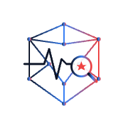

# Esteban Ibarra

**Full-stack engineer & founder — web, iOS, Android and AI systems, shipped end to end.**

12 years in emergency medical services, now building products across healthcare, real estate, fitness and commerce.

---

## Live products

<table>
<tr>
<td width="72" align="center" valign="top"></td>
<td valign="top">

**[Silverback OS](https://www.silverbackos.com)** · `beta` · web, iOS, Android 
An AI performance coach: workouts, nutrition, daily check-ins, ranks and a community feed, with native apps on both platforms. 
 &nbsp; SwiftUI · Jetpack Compose · Claude API · Stripe · RevenueCat · Sentry

</td>
</tr>
<tr>
<td align="center" valign="top"></td>
<td valign="top">

**[ParaNet](https://paranet.tech)** · `live` · web, iOS in progress 
The worldwide network for first responders: profiles, jobs, reviews, groups and messaging. 
 &nbsp; Radix UI · TanStack Query · SwiftUI · Sentry

</td>
</tr>
<tr>
<td align="center" valign="top"></td>
<td valign="top">

**[PropQuest.ai](https://propquest.ai)** · `live` · web, iOS in progress 
AI-native real estate investment platform: property search, research and underwriting in one workspace. 
 &nbsp; Mapbox · Meilisearch · LiveKit · Stripe · Expo / React Native

</td>
</tr>
<tr>
<td align="center" valign="top"></td>
<td valign="top">

**[Ascénd](https://www.ascendprive.shop)** · `live` · web 
Production e-commerce platform: storefront, checkout with stackable discount codes, customer accounts with Google sign-in and passkeys, an affiliate program with an earnings ledger, order tracking and an operator dashboard. 
 &nbsp; Upstash · Resend · Sentry · Claude API

</td>
</tr>
<tr>
<td align="center" valign="top"></td>
<td valign="top">

**[Foreclosure Leads CRM](https://esteban572.github.io)** · `preparing for Google Play` · Android 
Import foreclosure lists, find property owners from county GIS records, and track every call. 
 &nbsp; Expo · React Native · Cloudflare D1 · Sentry

</td>
</tr>
</table>

## In development

<table>
<tr>
<td width="72" align="center" valign="top"></td>
<td valign="top">

**Preceptor** · Android, iOS planned 
Offline-first study app for pre-licensure nursing students. 
 &nbsp; Kotlin Multiplatform · Compose Multiplatform · Material 3 · Room · Koin

</td>
</tr>
<tr>
<td align="center" valign="top"></td>
<td valign="top">

**Preflight** · web (PWA), Android 
Offline study and reference tool for flight-paramedic (FP-C) exam preparation. 
 &nbsp; PWA · IndexedDB · Jetpack Compose

</td>
</tr>
<tr>
<td align="center" valign="top"></td>
<td valign="top">

**Legacy Financial** · web 
Credit-repair brand site with a lead funnel and an owner dashboard. 
 &nbsp; Drizzle · Stripe · OpenAI · Framer Motion

</td>
</tr>
<tr>
<td align="center" valign="top"></td>
<td valign="top">

**Reservo** · web 
White-label booking and management for high-end barber shops. 
 &nbsp; NextAuth · Stripe · Resend

</td>
</tr>
<tr>
<td align="center" valign="top"></td>
<td valign="top">

**Tenantly** · iOS, Android, web 
Property management that connects landlords and tenants. 
 &nbsp; Ionic · Capacitor

</td>
</tr>
</table>

**Also building:** **Stark Intelligence**, AI orchestration that coordinates coding agents (Claude Code, Codex) under human approval gates · **Dialo**, an AI auto-dialer and CRM for real estate leads · **Payout OS** · medical equipment sourcing.

---

## Tech stack

**Languages** 

**Frontend & mobile** 

**Backend & data** 

**Cloud & DevOps** 

**AI, payments & services**

---

## What I work on

- **Product engineering:** web and native apps from schema to store listing: auth, payments, subscriptions, offline-first data, push, analytics
- **AI systems:** LLM features inside products, agent orchestration with human approval gates, MCP tool integrations
- **Backend & data:** Postgres/Supabase schemas and row-level security, APIs, webhooks, search, caching, background jobs
- **Healthcare & EMS:** software informed by 12 years in EMS: clinical education, exam prep, first-responder networks

Open to select contracts, consulting and technical partnerships.

---

Most of my product code lives in private repositories; the stack above is taken from those codebases.

